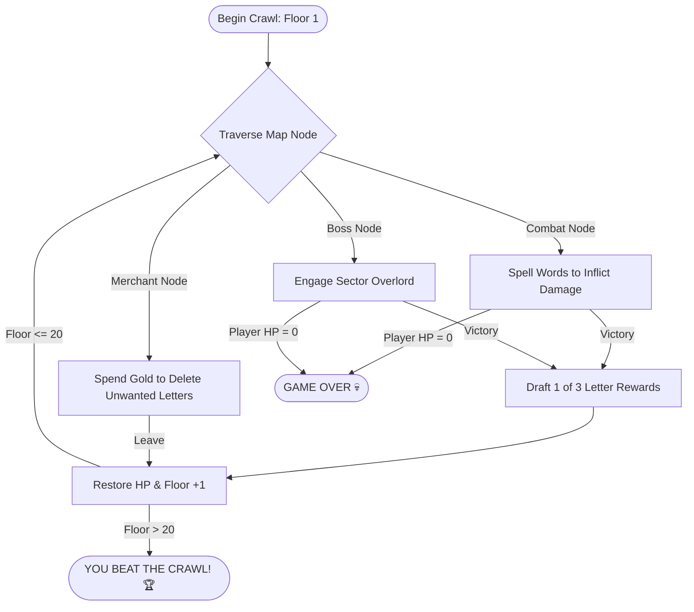

# Lexicon Crawler 📚⚔️

[](https://opensource.org/licenses/MIT)
[](https://react.dev)
[](https://vite.dev)
[](https://tailwindcss.com)
[](https://vitest.dev)

> A reactive, single-player web-based roguelite word game where players draft a dynamic deck of letters to climb the ascending floors of an ancient spelling dungeon. Defeat lexicographical monsters, manage your gold economy, trade with mysterious merchants, and construct high-scoring words!
>
> **Lexicon Crawler** blends the tactical drafting of *Slay the Spire* with the word-spelling combat of *Bookworm Adventures*, running entirely natively in the browser on high-performance reactive pipelines.

### 🎮 [Play the Live Native Demo Here!](https://stonedhawk.github.io/lexicon-crawler/)

---

## 📸 Core Game Loop Visualized



---

## ⚡ Key Features

| Feature | Description | Technical Execution |
| :--- | :--- | :--- |
| **Instant Dictionary Search** | Instantly validates any spelled word against the complete dictionary. | Uses an `O(1)` hash set holding **170,000+ cached words** (`ENABLE-12`) loaded on startup. |
| **Rogue-lite State Store** | Tracks decks, discards, hands, gold, health, streaks, and game progress globally. | Centralized state engine utilizing **Zustand** with persistent storage syncing. |
| **Optimized Combinatorics** | Computes the exact number of playable words remaining in your hand in real-time. | Recursive permutation tree with **branch pruning** to skip duplicate letter patterns. |
| **Kinetic Game Juice** | Dynamic physical reactions when drafting, shuffling, or attacking. | High-performance canvas micro-animations powered by **Framer Motion** and layout IDs. |
| **Tactile Keyboard Controls** | Play completely hands-free from the mouse, typing letters directly. | Interactive keyboard hook binding alphanumeric keys, `Backspace`, `Enter`, and `Spacebar`. |
| **Crash & Refresh Protection** | Never lose your floor progression if you accidentally close the browser tab. | Persistent local storage middleware safeguarding player variables across sessions. |

---

## 🎮 How to Play

### 1. Traversing the Map
Climb **20 distinct floors** of the crawling tower. Each floor features structural choices:
*   ⚔️ **Basic Encounter**: Battle low-tier lexicographical monsters to gain Gold and draft new letters.
*   🛍️ **Merchant**: Permanently discard hard-to-play consonants to maintain a slim, high-probability deck.
*   💀 **Sector Boss / final Overlord**: Challenging encounters with heavy-damage intents.

### 2. Spelling-Based Combat
You are dealt **7 letters** from your deck. Construct English words to cast attack spells!
*   **Draft**: Click on your cards or **physically type** the word on your keyboard.
*   **Shuffle**: Press the `Spacebar` (or click 🔀) to shuffle your hand and inspect new letter juxtapositions.
*   **Submit**: Press `Enter` (or click `SUBMIT`) to score and strike. If the word is valid, it heals your hero and damages the enemy. If misspelled, your combo streak drops to zero.

### 3. Rewards & Shop Economics
Defeating enemies grants **15 Gold** and lets you choose one of three random letters to add to your deck. Merchants charge escalating fees (**50g, 75g, 100g**) to slice a card out of your deck.

---

## 💡 Pro Strategies & Tips

*   ⚔️ **Combo Streak Scaling**: HP recovery scales aggressively off your spelling streak multiplier. Avoid guessing invalid words; a single invalid submission brutally wipes out your combo multiplier.
*   ✂️ **Keep a Lean Deck**: A bloated deck makes drawing vowels mathematically inconsistent. Delete awkward letters like **Q, Z, X, J** at merchants unless you have matching support vowels.
*   📊 **Inspect the Permutation HUD**: The HUD actively calculates the number of valid words possible from your exact hand composition. If `5L: 0` is shown, do not spend time trying to construct a 5-letter word—it is mathematically impossible!

---

## 🛠️ Architecture & Code Layout

```
├── public/                 # Static Assets
│   ├── enable1.txt         # 170,000+ cached word list
│   └── favicon.svg         # Game icon
├── src/
│   ├── components/         # Pure React view layout
│   │   ├── CombatView.jsx  # Main arena & keyboard handlers
│   │   ├── Enemy.jsx       # Enemy sprites & HP scales
│   │   ├── LetterCard.jsx  # Animated scrabble-style cards
│   │   ├── MapNode.jsx     # Ascending floor routing
│   │   ├── Shop.jsx        # Merchant deletion board
│   │   └── TopBar.jsx      # Stat dashboard
│   ├── data/
│   │   └── config.json     # Balanced monster metrics & intents
│   ├── store/
│   │   └── useGameStore.js # Global Zustand reactive state machine
│   ├── utils/
│   │   ├── dictionary.js   # O(1) validations & branch-pruned permutations
│   │   └── scoring.js      # Scrabble scoring matrices & starting decks
│   ├── index.css           # Tailwind CSS directives
│   └── main.jsx            # Application entrypoint
├── vitest.setup.js         # Test mocks for persist/JSDOM environments
└── vite.config.js          # Vite + Tailwind compilation scripts
```

---

## 🚀 Local Development Setup

To download, run, and modify this project locally, ensure you have [Node.js](https://nodejs.org) installed, and run the following terminal commands:

### 1. Install Dependencies
```bash
npm install
```

### 2. Run the Development Server
```bash
npm run dev
```
*The app will boot locally at `http://localhost:5173`.*

### 3. Run the Automated Test Suite
Ensure the state, economy, and card-removal math function with 100% precision:
```bash
npx vitest run
```

### 4. Build for Production
Compile and minify the app into static production assets (`/dist`):
```bash
npm run build
```

---

## 📄 License

This project is open-source and available under the [MIT License](LICENSE).
